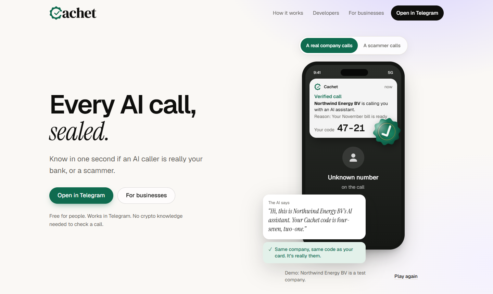
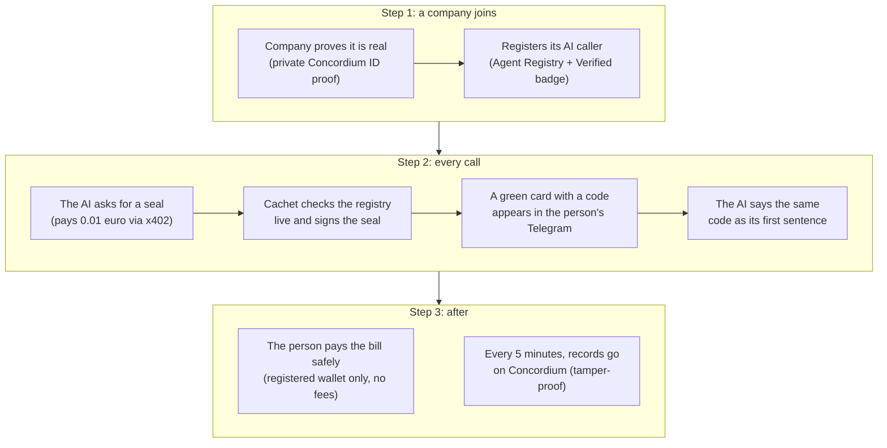
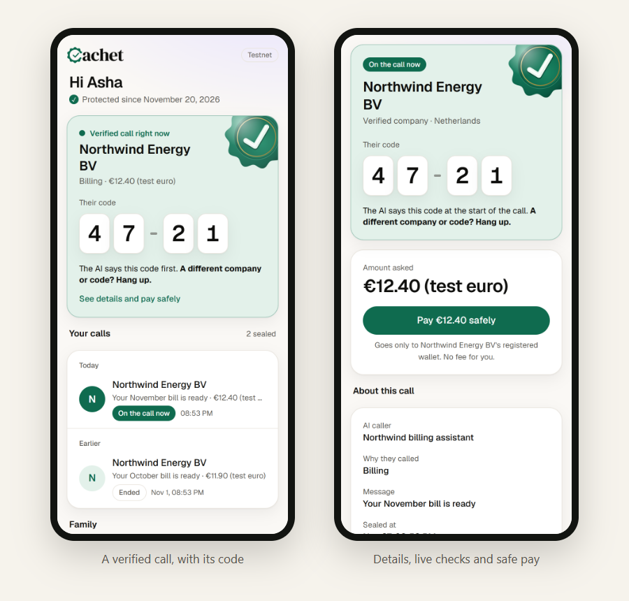
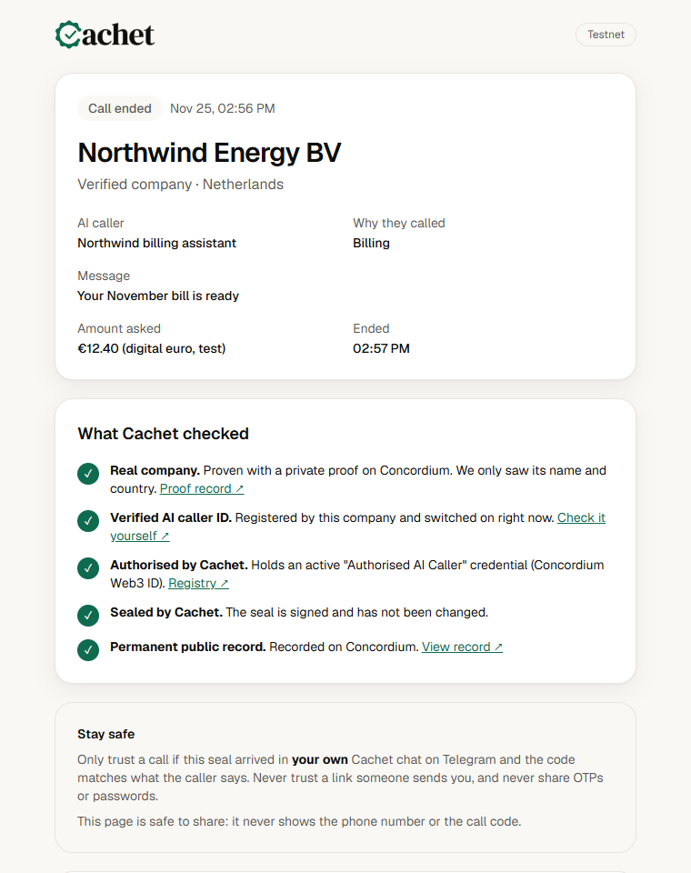
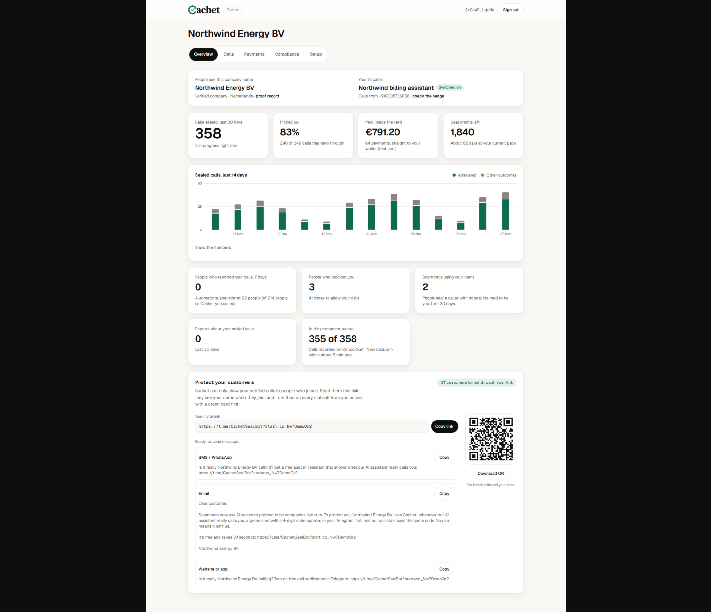
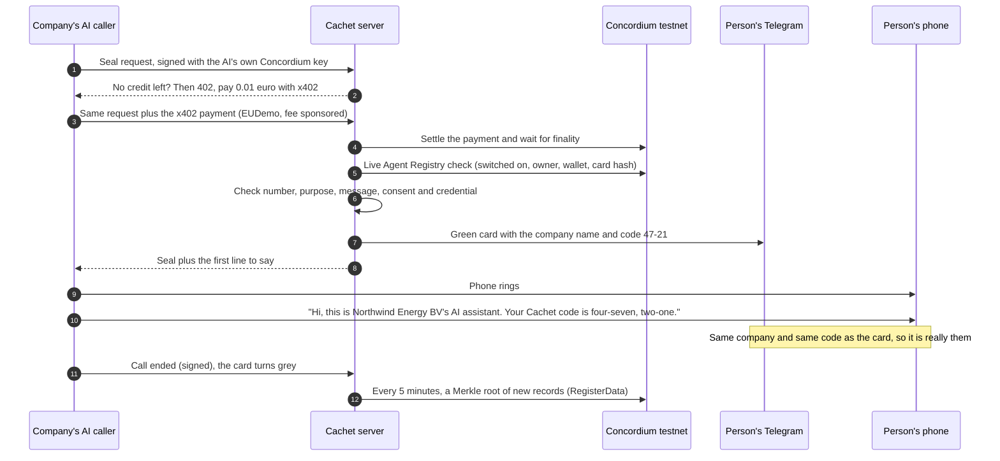
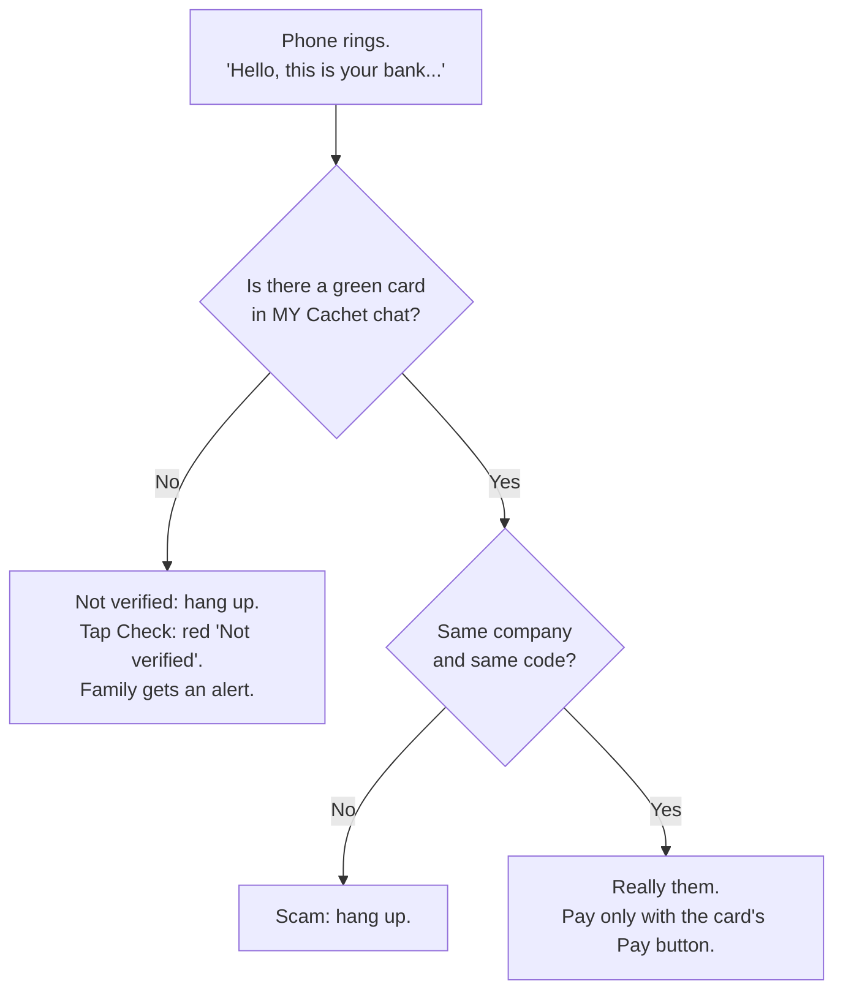
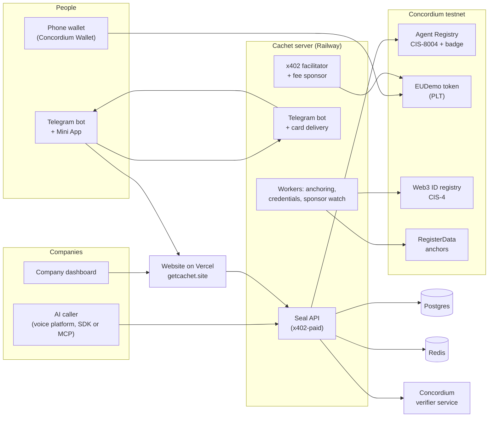

<p align="center">
  
</p>

<h3 align="center">The seal on every AI call.</h3>

<p align="center">
  Know in one second if an AI caller is really your bank, or a scammer.<br>
  Built on Concordium for the <b>Concordium Trusted Agents Hackathon</b> (Encode Club).
</p>

<p align="center">
  <a href="https://getcachet.site"><b>Website</b></a> ·
  <a href="https://t.me/CachetSealBot"><b>Telegram bot</b></a> ·
  <a href="https://getcachet.site/business"><b>Company dashboard</b></a> ·
  <a href="https://getcachet.site/developers"><b>Developer docs</b></a> ·
  <a href="https://getcachet.site/status"><b>Live status</b></a> ·
  <a href="#proof-on-the-chain"><b>Proof on chain</b></a>
</p>

<p align="center">
  
  
  
  
</p>



---

## Contents

- [The problem](#the-problem)
- [The idea in one picture](#the-idea-in-one-picture)
- [What it looks like](#what-it-looks-like)
- [How a real call works](#how-a-real-call-works)
- [How a scam call fails](#how-a-scam-call-fails)
- [Built on Concordium](#built-on-concordium) (every component, where it is used, and proof)
- [Proof on the chain](#proof-on-the-chain)
- [Does it work?](#does-it-work)
- [Architecture](#architecture)
- [Security and privacy](#security-and-privacy)
- [For companies and developers](#for-companies-and-developers)
- [Path to production](#path-to-production)
- [Run it yourself](#run-it-yourself)
- [What is not done yet](#what-is-not-done-yet)

---

## The problem

Banks, couriers and energy companies now phone people with **AI voices**. So do scammers, and they sound the same.
Caller ID can be faked in seconds. A person on the phone has **no way to check** who is really calling.

- **$893 million** lost in 2025 to scams that victims tied to AI, in the FBI's first-ever count of them
  ([FBI Internet Crime Report 2025](https://www.ic3.gov/AnnualReport/Reports/2025_IC3Report.pdf)).
- **22.99 billion** suspected spam calls flagged by India's phone networks in three months, April to June 2026
  ([TRAI, via Business Standard](https://www.business-standard.com/industry/news/trai-sees-drop-in-spam-calls-on-network-even-as-customer-complaints-rise-126111301906_1.html)).
- **1 in 4** Americans say they got a deepfake voice call in the past year
  ([Hiya, State of the Call 2026](https://www.hiya.com/newsroom/press-releases/state-of-the-call-2026-ai-deepfake-voice-calls-hit-1-in-4-americans-as-consumers-say-scammers-are-beating-mobile-network-operators-2-to-1)).

Laws are coming: the **EU AI Act (Art. 50)** requires AI callers to say they are AI, and regulators such as **TRAI** and the **FCC**
ask for consent and records. Companies need a way to prove "this call is really us", and people need a way to check it,
**without any crypto knowledge**.

## The idea in one picture

A real company's AI caller gets a **seal** before every call. The seal pops up in the person's own Telegram with a
4-digit code, and the AI says the same code. **No seal, or a different code, means it is a scam.**



## What it looks like

|                                    For people (Telegram Mini App, sample data)                                    |                                                       Public seal page (a real call)                                                        |
| :---------------------------------------------------------------------------------------------------------------: | :-----------------------------------------------------------------------------------------------------------------------------------------: |
|  |  |

**For companies:** a dashboard with their calls, payments, compliance report, customer invites and read-only API keys
(sample numbers below; the company and AI caller are the real test company on testnet).



## How a real call works



The seal arrives **before the phone rings** (measured: 95% of cards within 1.2 seconds).

## How a scam call fails



A scammer can fake a number and a voice, but **cannot make a card appear in your own Telegram**: only a company
that proved its identity, registered its AI caller on Concordium and paid for the seal can. When a person reports a
call, the bot asks who the caller claimed to be. If that company has told Cachet it **never** makes AI calls, the
person is told straight away that it is a scam, and the company sees "scam calls using your name" on its dashboard.

## Built on Concordium

Cachet uses **every** component the hackathon lists, each for a real job:

| Concordium component                                   | What Cachet does with it                                                                                                                                                                                           | Where in the code                                                                                              |
| ------------------------------------------------------ | ------------------------------------------------------------------------------------------------------------------------------------------------------------------------------------------------------------------ | -------------------------------------------------------------------------------------------------------------- |
| **Concordium ID (company identity) + Verify & Access** | A company proves with a **zero-knowledge proof** that it is a registered company. Only its legal name and country are revealed. The proof is bound to the signed-in account and anchored on chain (VRA/VAA).       | [`business/company-proof.ts`](apps/server/src/business/company-proof.ts), [`verify/`](apps/server/src/verify/) |
| **Agent Registry (CIS-8004)**                          | Every AI caller is a registered agent owned by the company account, with its Agent Card hash pinned on chain. **Every seal re-checks the registry live**: switched on, still owned by the company, card unchanged. | [`agents/`](apps/server/src/agents/), [`packages/concordium`](packages/concordium/src/)                        |
| **Verified by Concordium badge**                       | Shown on every seal page with a "check it yourself" link to Concordium's own badge checker (15 of 15 checks pass).                                                                                                 | [`v/[sealId]`](apps/web/app/v/)                                                                                |
| **Agent Card (ERC-8004 / A2A)**                        | Each card carries the badge plus our `cachet/v1` extension: calling numbers, call purposes, "never calls" flag.                                                                                                    | [`docs/extensions/cachet-v1.md`](docs/extensions/cachet-v1.md)                                                 |
| **x402 payments**                                      | The seal API is **x402-paid**: the AI caller pays 0.01 euro per seal (or buys credits). Cachet runs its own facilitator with `@x402/concordium` (Concordium's hosted one is a fallback).                           | [`x402/billing.ts`](apps/server/src/x402/billing.ts), [`facilitator/`](apps/server/src/facilitator/)           |
| **Protocol-Level Tokens**                              | All money is the test digital euro **EUDemo**: seal fees and bill payments.                                                                                                                                        | [`pay/`](apps/server/src/pay/)                                                                                 |
| **Sponsored transactions**                             | People pay bills with **zero CCD**: Cachet's sponsor pays the network fee. The recipient is always the AI caller's `agentWallet` read live from the registry, never from the call.                                 | [`pay/service.ts`](apps/server/src/pay/service.ts)                                                             |
| **On-chain anchoring (RegisterData)**                  | Every 5 minutes, a Merkle root of new seals, closings, payments, reports and consent changes is written on chain. Anyone can check that a seal was recorded and never changed.                                     | [`worker/`](apps/server/src/worker/)                                                                           |
| **Web3 ID (CIS-4 credential registry)**                | Cachet issues each AI caller an **"Authorised AI Caller"** credential and revokes it if the company is suspended. Seals stop at once.                                                                              | [`agents/credentials.ts`](apps/server/src/agents/credentials.ts)                                               |
| **Message signing**                                    | Companies sign in with their wallet; AI callers sign every seal request with their own account key (Cachet never holds it).                                                                                        | [`auth/`](apps/server/src/auth/), [`packages/sdk`](packages/sdk/src/)                                          |
| **MCP**                                                | A Cachet **MCP server** lets any MCP-capable AI agent seal its own calls, check companies and close seals. We also use the Agent Registry's hosted service for transaction builders and badge checks.              | [`packages/mcp`](packages/mcp/src/)                                                                            |

The person never sees any of this: no wallet is needed to check a call, and no crypto words appear in the bot.

## Proof on the chain

Every link below is a real, finalized transaction on the Concordium **testnet** (checked on 27 Nov 2026).

| What                                                             | Transaction                                                                                                                                                                                                                                                                                                                                                           |
| ---------------------------------------------------------------- | --------------------------------------------------------------------------------------------------------------------------------------------------------------------------------------------------------------------------------------------------------------------------------------------------------------------------------------------------------------------- |
| Company proves it is real (Verify & Access audit record)         | [f2b1b240…e6a9af](https://ccdexplorer.io/testnet/transaction/f2b1b2403cc2920d80303184e45448a56dd380d34465899b58a61a5168e6a9af)                                                                                                                                                                                                                                        |
| The proof request it answered (audit anchor)                     | [378fa2fd…c3bc](https://ccdexplorer.io/testnet/transaction/378fa2fd9cf313b8ddc9239263f69b2c6f9a8057c6f359ab58c1c225e166c3bc)                                                                                                                                                                                                                                          |
| AI caller registered in the Agent Registry (+ agentWallet set)   | [3a4b7532…b70b](https://ccdexplorer.io/testnet/transaction/3a4b75328b8cb1fa89a19bb3128966b48c16d40f006c85f7297f2c642c34b70b)                                                                                                                                                                                                                                          |
| Agent Card pinned on chain (setAgentURI)                         | [e4424e8e…44ad](https://ccdexplorer.io/testnet/transaction/e4424e8ea5722469b545d256c92fc91aedf38431d121a7413eaca25cadf644ad)                                                                                                                                                                                                                                          |
| x402: the AI caller buys 100 seals (1 EUDemo, fee sponsored)     | [41ebd94d…9b34](https://ccdexplorer.io/testnet/transaction/41ebd94d2709937b19fe455525e05a057a7a06a63350f75337d2f56a57489b34)                                                                                                                                                                                                                                          |
| x402: pay-per-seal, 0.01 EUDemo for one call                     | [524c02e5…24c6](https://ccdexplorer.io/testnet/transaction/524c02e57387ca0c4ce96e464ed7affb7a75fb2e5651e7d5b0165fcb638d24c6)                                                                                                                                                                                                                                          |
| A person pays a bill from their phone with **0 CCD** (sponsored) | [cf0364f4…9eb87](https://ccdexplorer.io/testnet/transaction/cf0364f41ef0d7ceedbec164bf55439f0f46e8c4e0c800d73f0f5a241099eb87)                                                                                                                                                                                                                                         |
| First seal record anchored (Merkle root)                         | [7710b598…d3ac](https://ccdexplorer.io/testnet/transaction/7710b59894cd358e701513a5ee5f859404270e4b201dfdab89a18a4a8554d3ac)                                                                                                                                                                                                                                          |
| Anchored by the live server                                      | [ff0787b6…a8ca](https://ccdexplorer.io/testnet/transaction/ff0787b6e35f41798bed8aeb6bc997787cc18d521760ed3f3c74661b6084a8ca)                                                                                                                                                                                                                                          |
| Web3 ID credential registry created                              | [935890a0…0b205](https://ccdexplorer.io/testnet/transaction/935890a0ed2b3e26578091a09e636694d156ab9d7fff6ed463c2bb355fe0b205)                                                                                                                                                                                                                                         |
| "Authorised AI Caller" credential issued / revoked / restored    | [issue](https://ccdexplorer.io/testnet/transaction/975f8d0b77cd269ba9dc217e07ed16173edebd421649d11d1c5797a932401ea9) · [revoke](https://ccdexplorer.io/testnet/transaction/ff7723c1528dbe29e2934dd74a4b10fec761f359e6b2a818de795dd49b91a39c) · [restore](https://ccdexplorer.io/testnet/transaction/3974f3bd343cecac6a15f3befe25cfaaa379b5bdec805aaf008cbce2ed86ee17) |

**Contracts and accounts**

- Agent Registry (CIS-8004): [`<12802,0>`](https://ccdexplorer.io/testnet/instance/12802/0) · our AI caller: token **#1297**, badge `JyP9UD2cnf5bw2YzH1GTX` ([check the badge](https://agent-registry-mcp.concordium.com/v1/check-badge/JyP9UD2cnf5bw2YzH1GTX))
- Cachet's Web3 ID credential registry: [`<13167,0>`](https://ccdexplorer.io/testnet/instance/13167/0)
- Test company "Northwind Energy BV" (a Global FinReg **test** identity): [3tCvWP…LqcNa](https://ccdexplorer.io/testnet/account/3tCvWPDYchFULvGXKc6Q3MzofopAgMzzL3KeRU66G2dM2LqcNa)
- Its AI caller's account: [33Rcud…9mr1jVq](https://ccdexplorer.io/testnet/account/33Rcud5xa7UZT3JQawDw9rhp5X14H8MPmfGR9E1uHQ59mr1jVq) · Cachet's fee sponsor: [35sHhK…pkB5z](https://ccdexplorer.io/testnet/account/35sHhKYuw7zk3iKZZjysLEh8BarcwxAJ4pQcZVB8kT9i4pkB5z)
- Seal-signing public key (verify any seal offline): [getcachet.site/.well-known/cachet-keys.json](https://getcachet.site/.well-known/cachet-keys.json)

## Does it work?

Yes. It runs live at [getcachet.site](https://getcachet.site), and it has been tested with **real phone calls**.

| Test                                                                                                                                                                                                                                                                                                 | Result                                                                                                                                                                        |
| ---------------------------------------------------------------------------------------------------------------------------------------------------------------------------------------------------------------------------------------------------------------------------------------------------- | ----------------------------------------------------------------------------------------------------------------------------------------------------------------------------- |
| Real AI phone call (voice platform: Bolna)                                                                                                                                                                                                                                                           | Seal issued in 0.5 s, card arrived in Telegram, code **64-07** shown and spoken, card ended when the call ended                                                               |
| Real bill payment from an Android phone (Concordium Wallet)                                                                                                                                                                                                                                          | Paid with **0 CCD**, only to the registry's `agentWallet` ([tx](https://ccdexplorer.io/testnet/transaction/cf0364f41ef0d7ceedbec164bf55439f0f46e8c4e0c800d73f0f5a241099eb87)) |
| **Red team: 1,000 simulated calls**: real calls, spoofed numbers, replayed and forged requests, expired and ended seals, a scammer calling during a real call, a switched-off AI caller, a suspended company, the wrong person, people probing others' calls, blocked companies, rule-breaking seals | **0 false greens**, 1,000 of 1,000 behaved exactly as designed ([`pnpm red-team`](apps/server/src/cli/red-team.ts))                                                           |
| Load test: 50 seals per second for 2 minutes                                                                                                                                                                                                                                                         | 6,000 of 6,000 issued, 95% within 131 ms (laptop test setup, [`pnpm load-test`](apps/server/src/cli/load-test.ts))                                                            |
| Card delivery to Telegram (50 runs)                                                                                                                                                                                                                                                                  | 50 of 50 delivered, 95% within 1.2 s                                                                                                                                          |
| Automated tests                                                                                                                                                                                                                                                                                      | **471 passing** (server, SDK, MCP, Concordium helpers, seal crypto, voice)                                                                                                    |
| Secret scan (gitleaks, full history) and dependency audit                                                                                                                                                                                                                                            | Clean                                                                                                                                                                         |
| Lighthouse (mobile, home page)                                                                                                                                                                                                                                                                       | Performance 94 · Accessibility 100 · Best practices 100 · SEO 100                                                                                                             |

## Architecture



- **One server process** ([`apps/server`](apps/server/src/)): Hono API, grammY Telegram bot, x402 facilitator and background workers.
- **Website** ([`apps/web`](apps/web/)): Next.js 16 (landing page, public seal pages, company dashboard, Telegram Mini App, developer docs).
- **Seal format**: canonical JSON (RFC 8785), signed with Ed25519, bound to a fingerprint of the person's number (never the number itself).
- **Records**: Merkle tree (leaf `0x00`, node `0x01` + sorted pair), root written as `"CACHET1" || root` with RegisterData.

More detail: [docs/architecture.md](docs/architecture.md) · protocol and API reference: [getcachet.site/developers](https://getcachet.site/developers).

**Tech stack:** TypeScript (strict) · Node 24 · pnpm + Turborepo · Hono · grammY · Next.js 16 + Tailwind ·
PostgreSQL + Drizzle · Redis · `@concordium/web-sdk` 12 · `@x402/concordium` · `@modelcontextprotocol/sdk` · Vitest ·
Playwright · Railway + Vercel.

## Security and privacy

- **Phone numbers** are stored only encrypted (AES-256-GCM) plus a keyed fingerprint for matching. They are never in
  seals, records, logs or company views. `/stop` in the bot deletes everything about a person.
- **Companies never see who a person is**: they get a private per-company code for each person, and only totals of reports.
- **Payments go only to the AI caller's registered wallet**, read live from the Agent Registry. A retry can never pay twice.
- **Abuse:** each seal is paid (x402); forged and replayed requests are refused and rate-limited; reports from people
  automatically suspend a company that misbehaves (its open calls end and its credential is revoked).
- **Website:** strict Content Security Policy, no framing by other sites, wallet sign-in with one-time challenges.

Full threat model (12 attacks and how each is stopped): [getcachet.site/developers#threats](https://getcachet.site/developers#threats) ·
reporting a vulnerability: [SECURITY.md](SECURITY.md).

## For companies and developers

A company adds Cachet to its AI caller in a few lines with the SDK:

```ts
import { createCachetClient } from '@cachet/sdk';

const cachet = createCachetClient({
  baseUrl: 'https://api.getcachet.site',
  badge: 'JyP9UD2cnf5bw2YzH1GTX', // the AI caller's Verified by Concordium badge
  account: AI_ACCOUNT, // the AI's own Concordium account
  signer: aiSigner, // its key: Cachet never holds it
  fetch: x402Fetch, // pays for a seal by itself when credits run out
});

const seal = await cachet.sealCall({
  to: '+31612345678',
  from: '+31201234567', // a registered calling number
  purpose: 'billing',
  message: 'Your November bill is ready',
});
agent.say(seal.firstLine); // "Hi, this is Northwind Energy BV's AI assistant. Your Cachet code is ..."
await cachet.closeSeal(seal.sealId, 'completed');
```

Or with **no code**, through the Cachet **MCP server** ([`packages/mcp`](packages/mcp/src/)): tools
`cachet_seal_call`, `cachet_close_seal`, `cachet_check_company`, `cachet_check_seal`. Companies can also pull their
own numbers with a **read-only API key**, invite their customers with a link and QR code, and print a **compliance
report** (EU AI Act Art. 50 and 12, TRAI, FCC) with on-chain proof for every call.

## Path to production

1. **Mainnet identities**: companies onboard with real company identities from Global FinReg; AI callers move to the
   mainnet Agent Registry (`<10082,0>`).
2. **Distribution**: one integration per voice-AI platform (Bolna, Vapi, Retell, Twilio, Exotel) seals calls for all their customers.
3. **People**: the Telegram bot needs no install; next an Android app that warns on incoming calls, and telecom partners.
4. **Regulation pulls demand**: EU AI Act disclosure and record keeping, TRAI and FCC rules. Cachet's anchored records make compliance easy.
5. **Business model**: 0.01 euro per sealed call via x402, free for people. Payments in a regulated euro token on mainnet.

Full plan, costs and the next 90 days: [docs/path-to-production.md](docs/path-to-production.md).

## Run it yourself

**Just try it:** open [@CachetSealBot](https://t.me/CachetSealBot) in Telegram and share your number. Companies sign in
at [getcachet.site/business](https://getcachet.site/business) with the Concordium browser wallet (testnet).

**Run the code** (Node 24, pnpm 12, Docker):

```bash
pnpm install
cp .env.example .env        # fill in the values; each one is explained in the file
pnpm gen-secrets            # creates Cachet's own secrets in .env (never printed)
pnpm db:up                  # Postgres + Redis + the Concordium verifier in Docker
pnpm dev                    # website on :3000, server on :8787
```

Useful commands: `pnpm test` (all tests) · `pnpm seal:smoke <badge> <number>` (issue a real seal on testnet) ·
`pnpm anchor:verify <sealId>` (check a seal's on-chain record yourself) · `pnpm red-team` · `pnpm load-test` ·
`pnpm mcp` (start the MCP server). Deployment: [docs/deploy.md](docs/deploy.md).

<details>
<summary><b>Repository map</b></summary>

```text
apps/
  server/        one Node process: api/ (Hono), bot/ (grammY), facilitator/ (x402), worker/ (anchoring,
                 credentials, sponsor watch), seals/, pay/, agents/, business/, cli/ (red team, load test)
  web/           Next.js: landing page, /v/<seal> public pages, /business dashboard, /tg Telegram Mini App,
                 /pay, /developers, /status
packages/
  shared/        seal crypto (JCS, Ed25519, Merkle, call codes, phone fingerprints), network constants
  concordium/    gRPC, Agent Registry, payments, credential registry, transaction sender
  db/            Drizzle schema and migrations (PostgreSQL)
  sdk/           @cachet/sdk for AI callers (seal, close, x402 paying fetch)
  mcp/           Cachet MCP server
  voice/         Bolna voice platform client (demo calls)
scripts/         testnet tools: seal smoke test, real call, credits, anchors, Web3 ID, deploy settings
infra/           docker-compose (Postgres, Redis, verifier) and the verifier image
docs/            architecture, path to production, deployment, Agent Card extension
```

</details>

## What is not done yet

Honest limits of this testnet prototype:

- **Testnet only.** The company is a Global FinReg **test** identity; money is the test euro EUDemo.
- **Calling-number ownership** is self-declared by the verified company (the card always shows the company's proven
  name, so this cannot create a false green). Proving number ownership is on the roadmap.
- **Automatic warnings without opening Telegram** need an Android call-screening app: on the roadmap.
- The "never calls" demo company needs its own test identity; the feature itself is built and tested.

## Author

Built by **Prashant Mishra** ([@Prashant-Mishra-12569](https://github.com/Prashant-Mishra-12569)).
