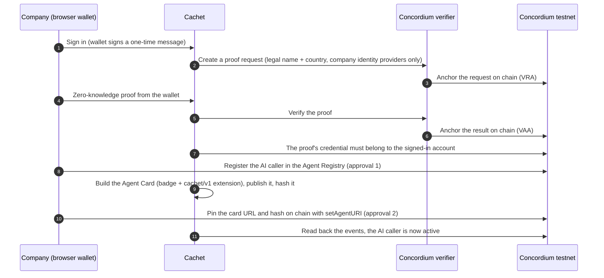
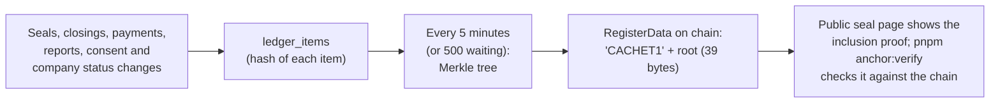
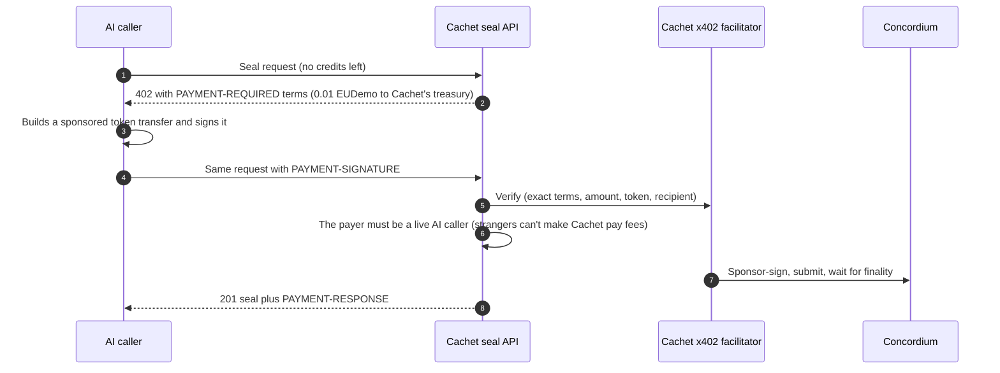
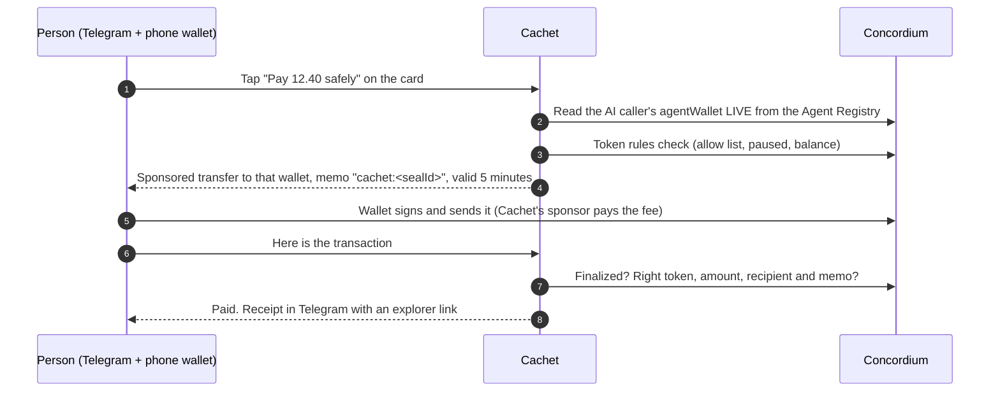
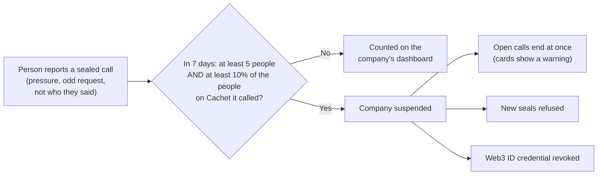

# Cachet architecture

This page explains how Cachet works inside, for judges and developers. For the short version, start with the
[README](../README.md). For the API and protocol reference, see [getcachet.site/developers](https://getcachet.site/developers).

## 1. The pieces

| Piece                  | What it is                                                                                                                   | Where                                                      |
| ---------------------- | ---------------------------------------------------------------------------------------------------------------------------- | ---------------------------------------------------------- |
| **Server**             | One Node 24 process: the seal API (Hono), the Telegram bot (grammY), the x402 facilitator and the background workers         | [`apps/server`](../apps/server/src/)                       |
| **Website**            | Next.js 16: landing page, public seal pages, company dashboard, Telegram Mini App, payment page, developer docs, status page | [`apps/web`](../apps/web/)                                 |
| **Seal crypto**        | Canonical JSON (RFC 8785), Ed25519 seal signatures, Merkle trees, call codes, phone fingerprints                             | [`packages/shared/src/seal`](../packages/shared/src/seal/) |
| **Concordium helpers** | gRPC client, Agent Registry reads and transactions, sponsored token transfers, credential registry, transaction sender       | [`packages/concordium`](../packages/concordium/src/)       |
| **Database**           | PostgreSQL with Drizzle (13 tables, 14 migrations) and Redis (sessions, one-time values, rate limits, live events)           | [`packages/db`](../packages/db/)                           |
| **SDK**                | `@cachet/sdk` for AI callers: seal a call, close it, pay with x402                                                           | [`packages/sdk`](../packages/sdk/src/)                     |
| **MCP server**         | Lets any MCP-capable AI agent seal its own calls, and an AI that answers calls verify the caller (receptionist mode, no key) | [`packages/mcp`](../packages/mcp/src/)                     |
| **Verifier**           | Concordium's credential verification service (Docker), checks companies' zero-knowledge proofs                               | [`infra/verifier`](../infra/verifier/)                     |

Live: the server, verifier, Postgres and Redis run on Railway; the website runs on Vercel at
[getcachet.site](https://getcachet.site); the API is at `api.getcachet.site`.

## 2. A company joins (about 3 minutes, two wallet approvals)

- Cachet **never holds the company's key**: the company approves its own transactions in its wallet.
- The proof reveals only the **legal name and country**, nothing else about the company or its owners.
- A suspended company cannot start fresh by proving itself again from another account.
- One AI account can belong to only one live AI caller (a database rule).

## 3. The seal

Before every call, the AI caller sends a **seal request** and signs it with its own Concordium account key, using the
wallet message-signing scheme over `cachet:seal-request:v1:<sha256(JCS(request))>`. Cachet then checks, in this order:

1. The badge belongs to a live AI caller, and the account matches it (cheap database checks first).
2. The request is fresh (±120 s), signed by that account, and its one-time nonce was never used (replays are refused).
3. The company is verified, not suspended, and has not declared that it "never makes AI calls".
4. **Live Agent Registry check**: the AI caller is switched on, still owned by the company, has a payment wallet, and its
   pinned card hash is unchanged.
5. Its Web3 ID "Authorised AI Caller" credential is not revoked.
6. The calling number and the purpose are registered for this AI caller; the message is 80 characters or less, with no
   links and no long numbers (no fake callback numbers); an amount is only in the payment token.
7. The person has not blocked this company.
8. A seal credit is spent (or, with none left, an x402 payment of 0.01 euro is asked for).

The seal Cachet signs (Ed25519, public key at [`/.well-known/cachet-keys.json`](https://getcachet.site/.well-known/cachet-keys.json)):

| Field                                  | Meaning                                                                                      |
| -------------------------------------- | -------------------------------------------------------------------------------------------- |
| `id`                                   | ULID                                                                                         |
| `network`                              | CAIP-2 chain id (testnet `ccd:4221332d…`)                                                    |
| `company`                              | Legal name, country, account and the on-chain proof transaction                              |
| `agent`                                | CAIP-19 badge, token id, the AI's account, the request digest and the AI's signature         |
| `callee.phoneHash`                     | A keyed fingerprint of the person's number (never the number)                                |
| `from`, `purpose`, `message`, `amount` | What the card shows                                                                          |
| `code`                                 | 4 digits from `HMAC(secret, sealId)`, weak codes (like 1111 or 1234) skipped                 |
| `issuedAt`, `expiresAt`                | A seal lives 15 minutes at most; it closes as soon as the call ends                          |
| `consent`                              | `granted` only if the person allowed this company; otherwise `none_recorded` (never implied) |
| `payment`                              | The x402 settlement or credit purchase that paid for it                                      |
| `cachetSig`                            | Cachet's Ed25519 signature over the canonical JSON                                           |

Only **one seal is open per AI caller and person**: a new one replaces the old one, so an old code can never be reused.

## 4. The permanent record (anchoring)

- Leaves are `0x00 || hash`, inner nodes `0x01 || sorted pair`, so a proof never needs left/right flags.
- A record can be checked by anyone without trusting Cachet: the root is on Concordium, the proof is public, and no
  phone number or code is in any item.
- This is the kind of tamper-proof log the EU AI Act (Art. 12, record keeping) asks for.

## 5. Paying for seals with x402

- Built with the official `@x402/concordium` package. Cachet runs its own facilitator; Concordium's hosted
  facilitator is supported as a fallback (with a safety net that finds the finalized transfer if its answer is wrong).
- An AI caller can also buy credits in advance (`POST /v1/credits/purchase?credits=100`).

## 6. Paying a bill safely (zero CCD)

- The **recipient is never taken from the call or the person**: only from the registry.
- A double tap or a retry gets the same transfer back, so a bill can never be paid twice.
- On phones, Telegram can't open wallet apps, so the Mini App hands over to the phone's browser with a one-time pass
  that works for that one bill for 30 minutes.

## 7. The Telegram side

- `/start` → the person shares **their own** number (Telegram confirms it belongs to that account).
- Cards are pushed the moment a seal is issued (Redis pub/sub), and a sweep every 15 s catches anything missed
  (restarts, closed or expired seals). Measured: 50 of 50 cards delivered, 95% within 1.2 s.
- `/check` ("is this call real?"), `/history`, `/company <name>`, `/consent` (allow or block companies),
  `/family` (protect a parent, **with their consent**), `/privacy`, `/stop` (delete everything).
- The Mini App checks Telegram's signature on every request. A seal belonging to someone else answers exactly like a
  missing one, so seal ids can't be probed.

## 8. Web3 ID: the "Authorised AI Caller" credential

- A CIS-4 credential registry created from Concordium's own template module (`<13167,0>` on testnet).
- Holder = the AI caller's own account key; issuer = Cachet. Metadata and schema are served at
  [`getcachet.site/w3id/`](https://getcachet.site/w3id/issuer.json).
- A background job issues the credential to every live AI caller and **revokes** it if the company is suspended.
  Every seal checks it, so a revoked credential stops all seals at once.

## 9. When a company misbehaves

The company sees only totals of reports per kind, never which call was reported, so people can report safely.

## 10. Data model

| Table                              | Holds                                                                                           |
| ---------------------------------- | ----------------------------------------------------------------------------------------------- |
| `businesses`                       | Verified companies: legal name, country, proof transactions, status, "never calls", invite code |
| `agents`                           | AI callers: account, token id, badge, wallet, card URL and hash, numbers, purposes, status      |
| `seals`                            | Every seal: canonical signed JSON, hash, status, code, fingerprint of the person's number       |
| `ledger_items`, `anchors`          | Items waiting for and included in on-chain Merkle roots                                         |
| `seal_credits`, `credit_purchases` | Prepaid seals and the x402 transactions that bought them                                        |
| `payments`                         | Bills paid inside a card (one per seal, one per transaction)                                    |
| `people`                           | Telegram users: encrypted number (AES-256-GCM) and its fingerprint                              |
| `guardians`, `consents`, `reports` | Family links (with consent), allow/block choices, reports                                       |
| `api_keys`                         | Companies' read-only keys (only a SHA-256 hash is stored)                                       |

## 11. Limits that protect people and Cachet

| Where                              | Limit                                                                                          |
| ---------------------------------- | ---------------------------------------------------------------------------------------------- |
| Seal API                           | 60 requests per second per IP; forged, replayed or unknown requests: 300 per 10 minutes per IP |
| Sign-in                            | One-time challenges (5 minutes), 30 per 10 minutes per visitor                                 |
| Company proofs (they cost CCD)     | 5 per 10 minutes per account, 10 per visitor                                                   |
| Bill payments                      | One payment in flight per bill, at most 5 tries per bill per hour                              |
| Mini App                           | Per visitor and per person; reports once per call                                              |
| Call verification (agent to agent) | 10 tries per answered number and 60 per visitor per 10 minutes                                 |
| Data API                           | 120 requests per 10 minutes per company                                                        |

Behind the website, the visitor's real IP is passed with a secret shared by the website and the server, so one visitor
can't use up everyone's limits.
